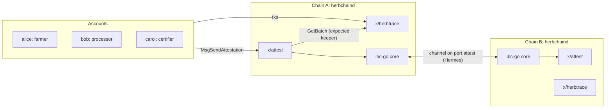
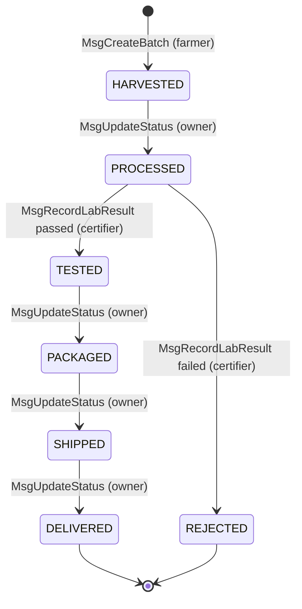

# HerbChain

HerbChain is an app-specific Cosmos SDK chain, scaffolded with Ignite, that tracks Ayurvedic herb batches from harvest to delivery.

- `x/herbtrace` keeps each batch as an on-chain state machine with enforced transitions, custody, lab results and an append-only history.
- `x/attest` sends a batch's lab-result attestation to a second HerbChain instance over a custom IBC packet (`AttestationPacket`, port `attest`), relayed by Hermes.

It ports the Hyperledger Fabric chaincode `herbTraceability.js` ([parthg2112/chaincode](https://github.com/parthg2112/chaincode)) to a native module. The Fabric version accepts any status from any caller. This one does not. See [docs/design.md](docs/design.md#differences-from-the-fabric-chaincode).

## Architecture



Both chains run the same binary. Chain A is the origin of a batch. Chain B (a regulator or importer, say) stores attestations it receives. Acks and timeouts flow back to chain A, which records the delivery outcome.

## Batch state machine



- One step forward at a time. All legal pairs live in one pure function, `types.ValidateTransition(from, to)`.
- Only the current `owner` can move a batch to PROCESSED, PACKAGED, SHIPPED or DELIVERED.
- Only an address in `params.certifiers` can move a batch to TESTED or REJECTED, and only from PROCESSED.
- `MsgTransferCustody` changes `owner` in any non-terminal state and leaves `status` unchanged.
- DELIVERED and REJECTED are terminal. Every msg on a terminal batch fails.
- Every state change appends a `HistoryEntry` and emits a typed event (`EventBatchCreated`, `EventStatusUpdated`, `EventLabResultRecorded`, `EventCustodyTransferred`).

## Messages and queries

| Msg | Signer | Effect |
|---|---|---|
| `MsgCreateBatch` | farmer | New batch, `status=HARVESTED`, `owner=farmer` |
| `MsgUpdateStatus` | owner | Owner-driven step (PROCESSED, PACKAGED, SHIPPED, DELIVERED), optional new location |
| `MsgRecordLabResult` | certifier | PROCESSED → TESTED (`passed=true`) or REJECTED, stores `lab_report_hash` |
| `MsgTransferCustody` | owner | Sets a new owner, updates the owner index |
| `MsgUpdateParams` | x/gov authority | Replaces certifiers and `max_certifications` |
| `MsgSendAttestation` (x/attest) | any | Sends an `AttestationPacket` for a batch in TESTED or later |

herbtrace queries (gRPC, REST, autocli `herbchaind q herbtrace ...`): `params`, `batch [id]`, `batches`, `batch-history [id]`, `batches-by-owner [owner]`, `batches-by-status [status]`. Every list query paginates with `query.CollectionPaginate`.

attest queries: `Attestation(channel, batch_id)`, `Attestations`, `SentAttestation(channel, batch_id)`, `SentAttestations`.

## Store layout

`x/herbtrace` (all state through `cosmossdk.io/collections`):

| Prefix | Collection | Key | Value |
|---|---|---|---|
| `p_herbtrace` | `Params` | none (Item) | `Params` |
| `0x01` | `Batches` | `string` id | `Batch` |
| `0x02` | `History` | `Pair[string id, uint64 seq]` | `HistoryEntry` |
| `0x03` | `HistorySeq` | `string` id | `uint64` next seq |
| `0x04` | `OwnerIndex` | `Pair[sdk.AccAddress owner, string id]` | KeySet |
| `0x05` | `StatusIndex` | `Pair[int32 status, string id]` | KeySet |

`OwnerIndex` and `StatusIndex` are derived. They are written only by the keeper's single batch write path, never exported, and rebuilt in `InitGenesis`.

`x/attest`:

| Prefix | Collection | Key | Value | Written on |
|---|---|---|---|---|
| `p_attest` | `Params` | none (Item) | `Params` | both |
| `attest-port-` | `Port` | none (Item) | bound port id | both |
| `0x01` | `Attestations` | `Pair[string channel, string batch_id]` | `Attestation` | receiver |
| `0x02` | `SentAttestations` | `Pair[string channel, string batch_id]` | `SentAttestation` (PENDING, ACKED, ERRORED, TIMED_OUT) | sender |

`channel` is the local channel end on each chain: the destination channel for `Attestations` and the source channel for `SentAttestations`.

## Quickstart

Ignite does not support native Windows. On Windows use WSL2 Ubuntu 24.04 and keep the repo on the Linux filesystem (`~/code/herbchain`), not `/mnt/c`.

Prerequisites: Go 1.26.x, Ignite CLI v29.10.1, `jq`, `make`, `git`. Install Go and Ignite from their release archives and check the published checksums. Do not pipe install scripts into a shell.

```sh
make build        # build/herbchaind
make test         # go test ./...
make cover        # coverage for ./x/...
make lint         # golangci-lint v2.14.0 (make lint-install) + buf lint
```

### Phase 1: single chain

```sh
make serve        # terminal 1: ignite chain serve --reset-once, config.yml
make demo         # terminal 2: scripts/demo.sh
```

`ignite chain serve` installs `herbchaind` into `$(go env GOPATH)/bin`, so that directory must be on `PATH`. Its home is `~/.herbchain` with the `test` keyring.

`scripts/demo.sh` walks one batch through the full lifecycle:

1. alice creates it.
2. alice processes it and hands custody to bob.
3. carol records a passing lab result.
4. bob packages, ships and delivers it.

It then checks the history and the by-status and by-owner queries. It also expects four rejections: a wrong signer, a skipped transition, a lab result from a non-certifier and an update to a terminal batch. Each tx waits for block inclusion, and the script checks the result code and codespace. It exits non-zero on the first unexpected result. Batch ids carry a timestamp, so the script can be re-run against the same chain. Override `BIN`, `NODE`, `HOME_DIR`, `FEES` or `GAS` through the environment.

### Phase 2: two chains + Hermes

```sh
scripts/relayer.sh up      # init chain-a.yml + chain-b.yml, start both, install pinned Hermes, open the attest channel, relay
make demo-ibc              # scripts/demo-ibc.sh
scripts/relayer.sh down    # stop Hermes and both chains
```

| | Chain A | Chain B |
|---|---|---|
| Config | `chain-a.yml` | `chain-b.yml` |
| chain-id | `herbchain-a` | `herbchain-b` |
| Home | `~/.herbchain-a` | `~/.herbchain-b` |
| RPC | `26557` | `26457` |

`relayer.sh` initialises each chain with `ignite chain init -c chain-X.yml` and then runs `herbchaind start`. It does not use `ignite chain serve`, which rebuilds and restarts the chain on every source change and would kill it mid-demo. `ignite chain serve -c chain-a.yml` and `-c chain-b.yml` also work for interactive use. `RESET=1` re-initialises both chains.

`scripts/relayer.sh` also exposes the individual steps: `chains-up`, `setup`, `start`, `stop`, `status`, `channel`.

`scripts/demo-ibc.sh` takes a batch to TESTED on chain A, sends the attestation and waits for the relay. It then queries the attestation on chain B and ACKED on chain A. It also covers a duplicate send (error ack) and a timeout (short timeout with the relayer paused).

## Dev accounts

Defined in `config.yml` with pinned mnemonics so addresses are deterministic. **DEV-ONLY. Never fund these keys on a real network.**

| Name | Role | Address |
|---|---|---|
| alice | farmer | `herb1trjvk0a7m5ta4ms2xayet88d9pe99dmynz25kw` |
| bob | processor | `herb1u99a07k3j7yksmzshh7n64haqjg3u8eknzcwz3` |
| carol | certifier (in genesis `params.certifiers`) | `herb182cq5qpwux45lysl2ud2ek9txym8c7fwges8ju` |
| validator | validator operator | `herb1ge8vpfu8n4syv7pxdsflq7c2atl7qnga04v99f` |
| relayer | Hermes key | `herb1v5p4d4ld2r47w3urv2ukzw4mg56nppdyy7jz7r` |

## Pinned versions

| Component | Version |
|---|---|
| Go | 1.26.8 (`go.mod`: `go 1.26.7`) |
| Ignite CLI | v29.10.1. The release binary reports `v30.0.0-rc.2-dev` in `ignite version`. |
| Cosmos SDK | v0.53.6 |
| ibc-go | v10.4.0 |
| CometBFT | v0.38.21 |
| Hermes | v1.13.3, a sha256-pinned release binary installed by `scripts/relayer.sh install`. The binary self-reports 1.13.2. |
| buf | 1.73.0 (go.mod `tool`) |
| golangci-lint | v2.14.0 |
| Dev OS | WSL2 Ubuntu 24.04 |

Go 1.26 is required: Ignite v29.10.1 needs Go 1.25.4 or later, and its scaffolded `buf` v1.73 tool needs Go 1.26.7 or later.

## Make targets

| Target | Action |
|---|---|
| `build` / `install` | Build `herbchaind` into `build/` / `$GOPATH/bin` |
| `test`, `test-race`, `cover` | Unit tests, race detector, coverage for `./x/...` |
| `lint` | `lint-go` (golangci-lint) + `lint-proto` (buf lint) |
| `proto-gen` | `ignite generate proto-go` |
| `serve` | `ignite chain serve --reset-once` with `config.yml` |
| `demo`, `demo-ibc` | `scripts/demo.sh`, `scripts/demo-ibc.sh` |

CI (`.github/workflows/ci.yml`) runs `go build ./...`, `go test ./...` with coverage, golangci-lint v2.14.0 and `buf lint`.

## Known limitations

- Certifiers are a flat address list in params, changed only by governance. There are no per-herb scopes, expiries or revocation of past results.
- Batch ids are user-supplied and first-come-first-served, so one account can squat an id.
- A batch moves as one unit. There are no splits, merges or partial shipments.
- Only the lab report's sha256 is on chain. The report lives off chain, and nothing proves that the hash matches a real document.
- Origin coordinates, harvest time (bounded only by block time) and location text are self-reported by the signer.
- Chain B trusts chain A's certifier set. IBC proves that the packet came from chain A's `attest` port, not that the lab result is true.
- Attestations carry `status` as a string, so the two chains do not share an enum version.
- The dev setup runs one validator per chain, with dev-only keys in a `test` keyring.
